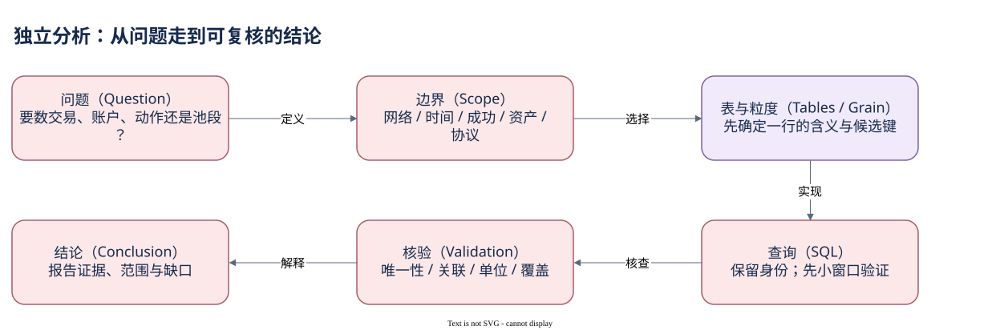

# 08.00 从业务问题出发

当有人问“这个协议今天活跃吗”，你现在应该先把问题改写成可观察对象。活跃可以指交易数、调用数、签名账户数、池段数或资金量；它们都可能有用，却不会自动变成同一个指标。

独立分析的第一步是确定想解释的行为与范围。研究网络负载可以从区块计数开始，研究费用与成功率从交易表开始，研究程序调用从 instruction_calls 开始，研究逐账户余额观察用 account_activity，研究统一资产移动和成交段则选择相应整理表。选表的标准是一行能否直接代表你的主对象。

第二步是写边界：网络、时间、时区、成功状态、是否投票、Mint 与程序版本。一个地址只在主网观察时有特定含义，同名资产不一定是相同 Mint，当前 owner 也不保证拥有全部历史。边界没有写清楚，后面的 SQL 即使很复杂，结果也可能回答另一个问题。

第三步从小样本建立对象关系。固定一笔 signature，核对请求、结果、调用与账户变化，先让这些层在最小范围内对得上。不要先扫全历史再试图从几亿行中理解未知协议。样本用于建立结构和检查口径，不能顺手把它外推成全网比例。

第四步再扩大统计。聚合到所需粒度后检查候选键、JOIN 扇出、单位、估值覆盖和更新延迟。新增数据版本和程序升级可能影响字段或解码，缓存要注明读取日期。一个图发生突变时，先区分真实行为变化与索引、覆盖、价格或模型变更，而不是立即补一个生态故事。

最后写出能被复查的结论。例如“在某完整 UTC 窗口，观察到某程序对应的成功交易数”，比“今天用户暴增”更准确。需要人类用户或最终资金归属时，还要额外身份与控制证据。缺少证据时限定结论，并不削弱分析，反而说明你知道数据支持到哪一层。

本模块用钱包资金流与陌生协议两个场景实践这套路线，再说明怎样保存 SQL、结果和核验状态。它不要求新的全链扫描或复杂模型；前面已经具备的对象关系足以构造多数基础分析。

当方法稳定以后，面对 NFT、质押或其他应用也可以重复同样的提问：资产状态在哪里、程序怎样授权、哪张表记录什么行为。具体协议需要自己的接口与覆盖核验，不能因为都运行在 Solana 上，就照搬 Token transfer 或 DEX 的口径。

本模块阅读顺序：

- [钱包行为与资金流向](./01-wallet-flow.md)
- [研究陌生协议](./02-protocol.md)
- [让分析可重现](./03-reproducibility.md)
- [拥有自己的分析路线](./summary.md)

[编辑原图（draw.io）](./assets/analysis-route.drawio)

参考来源（核验日期：2026-10-09）：

- [Dune Transactions](https://docs.dune.com/data-catalog/solana/transactions)
- [Dune Instruction Calls](https://docs.dune.com/data-catalog/solana/instruction-calls)
- [Dune Account Activity](https://docs.dune.com/data-catalog/solana/account-activity)
- [Dune Transfers](https://docs.dune.com/data-catalog/curated/token-transfers/solana/solana-token-transfers)
- [Dune DEX 模型](https://docs.dune.com/data-catalog/curated/dex-trades/solana/solana-dex-trades)
- [Solana Programs](https://solana.com/docs/core/programs)

<!-- NAV -->

[总目录](../README.md) · [上一章：让不同视角回到同一事实](../07-cases/summary.md) · [下一章：钱包行为与资金流向](01-wallet-flow.md)
