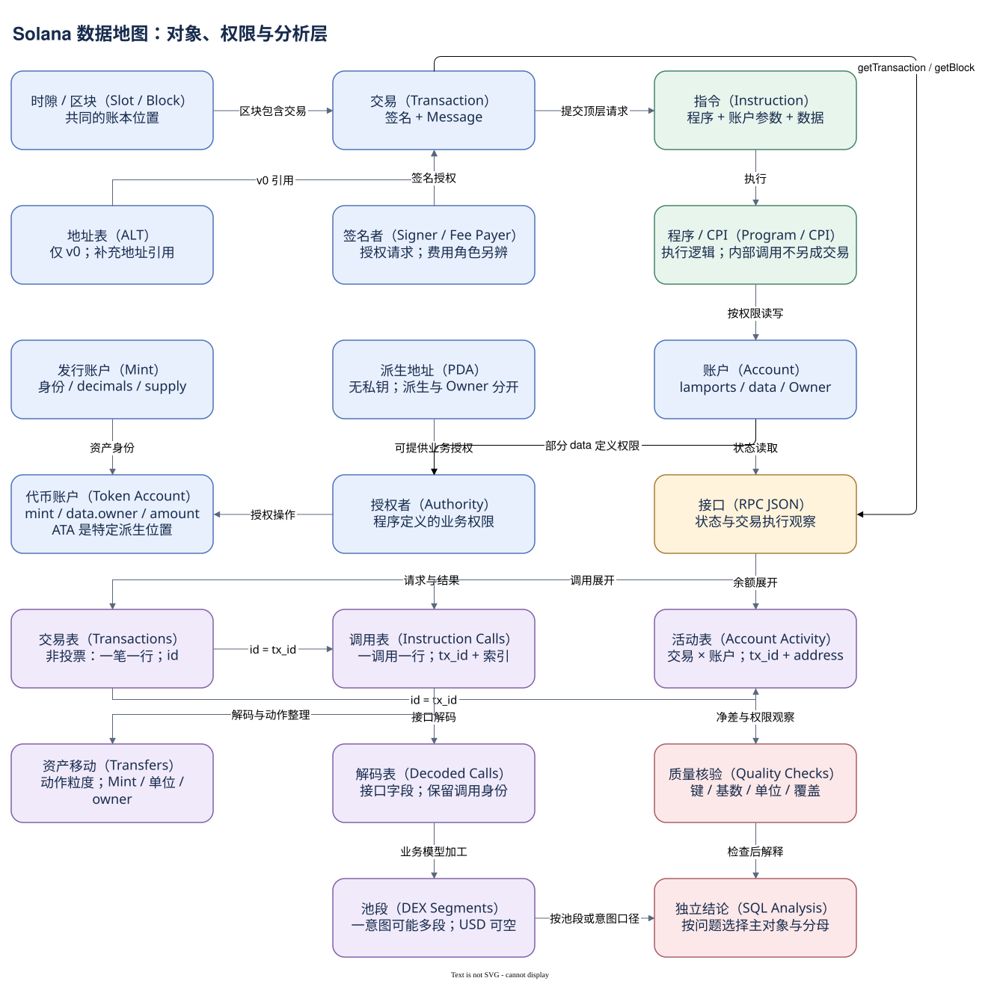

# 99.00 你的 Solana 数据地图

现在面对一笔陌生 Solana 交易，你可以先提出几个明确问题：它处于哪个账本位置？请求包含哪些账户和指令？谁授权，谁付费？程序执行了什么？哪些状态最终改变？仓库又怎样把这些事实组织成可查询记录？这些问题连起来，就是本篇的数据地图。

**把链上对象连起来。** Slot 表示出块机会，Block 组织已产出的交易。交易包含签名与 Message，Message 指定账户和顶层指令。指令调用程序，程序按权限读写账户，并可能产生 CPI。CPI 沿用原交易的身份和执行边界；它会增加调用行，而不会凭空增加一个新的用户签名交易。

账户保存状态，基础 Owner 决定由哪个程序解释和修改数据；业务 Authority 决定某项操作如何获得授权。PDA 提供确定地址和受运行时检查的内部授权，派生本身不创建状态，也不自动决定基础 Owner。SOL 余额在 lamports，Token 余额通常在 Token Account data；Mint 给出资产身份与单位，ATA 只是按完整规则确定的常用账户位置。

**把一次业务拆成证据。** 简单 SOL 案例只有一条 transfer，发送者净减少等于接收者增加加 fee。Token 案例移动两个账户的余额，却没有造成共同 owner 的合计外流。路由案例同时出现 CU 设置、WSOL 准备、CPI、转账和清理，内部中间转入额不等于最终持久支出。复杂业务需要多层观察，不能用一个字段代替全部过程。

**把接口与仓库连起来。** RPC 按方法、版本和编码返回状态或历史执行观察。Dune 基础表将交易、调用和账户活动展开；Decoded 解释程序接口；Curated 统一资产移动与 DEX 池段等模型。symbol、价格和项目标签属于有来源的加工信息，不因与 tx_id 同行就变成签名请求的一部分。综合图表示语义关系与分析血缘，具体覆盖仍由源表与模型确认。

选择 SQL 入口时，可用下面的对应关系。

| 分析问题 | 起点 | 先守住的口径 |
| --- | --- | --- |
| 网络块与交易总体 | solana.blocks | Slot 与 Block、投票/非投票、完整 UTC 日 |
| 费用、签名、成功率 | solana.transactions | 非投票交易，一笔一行 |
| 程序触达与 CPI | solana.instruction_calls | 调用数和去重交易数分开 |
| 账户使用与净差 | solana.account_activity | 交易 × 账户；余额不代表全部 data |
| 资产移动 | tokens_solana.transfers | action、Mint、单位、owner 与账户层级 |
| 代币关系与展示属性 | token_accounts / fungible | 候选唯一性与历史时点 |
| 协议池交易 | dex_solana.trades | 池段不等于意图；USD 缺值单列 |

关联的主骨架是 `blocks.slot = transactions.block_slot`，以及交易 `id = instruction_calls.tx_id = account_activity.tx_id`。它们的关系是 1 对多，不能把多份明细同时展开后直接 SUM 交易级费用。raw 与 decoded 的调用 identity 还需要 outer、NULL-safe inner 索引及执行程序。金额 JOIN Mint 元数据时，同样先检查匹配次数。

**用对比较方法。** 以太坊虚拟机（Ethereum Virtual Machine，EVM）体系的分析常从交易、调用轨迹与结构化事件日志连接合约行为；Solana 分析更需要显式读取 Instruction、Program 与 Account 参数关系。Solana 日志字符串不能机械套成 EVM event，Token Account 也不能机械套成钱包地址。两者共享 SQL 粒度与关联方法，但对象模型必须分别理解。

**独立研究一个协议。** 先把业务问题改写为可观察对象，固定网络、时间、成功范围、Program 和 Mint。找一笔实际交易，用 RPC 和接口定义验证角色与金额，再检查 Dune 的具体映射与覆盖。小范围闭环成立后扩大统计，保留精确候选键、单位、NULL 覆盖与关联 QA。结果异常时先排除窗口、索引、版本和模型变化，再解释业务原因。

下面给出一个交易级起点：找出在短窗口内包含 System Program 调用的交易。EXISTS 只判断触达，保留交易一行，不会因多次调用复制 fee。


SQL 验证状态：字段已按官方 Schema 或当前已保存 SQL 核对；本书版本仅完成静态检查，尚未执行。

```sql
SELECT t.id, t.success, t.fee
FROM solana.transactions t
WHERE t.block_date = DATE '2026-10-07'
  AND t.block_time >= TIMESTAMP '2026-10-07 00:00:00'
  AND t.block_time <  TIMESTAMP '2026-10-07 00:01:00'
  AND EXISTS (
      SELECT 1 FROM solana.instruction_calls i
      WHERE i.tx_id = t.id
        AND i.block_time >= TIMESTAMP '2026-10-07 00:00:00'
        AND i.block_time <  TIMESTAMP '2026-10-07 00:01:00'
        AND i.executing_account = '11111111111111111111111111111111'
  )
ORDER BY t.block_slot, t."index"
LIMIT 10
```

这份查询用于观察触达，不单独证明发生转账。当前全书的教学 SQL 保留静态验证状态；真实案例的 RPC 与本地算术核验已经完成，Dune 交叉执行没有发生。来源和查询索引使这条边界可以继续维护。

你不必记住所有字段才能开始。记住对象在哪里、哪一行代表什么、关系怎样连接，以及结论需要哪一类证据。然后用一笔交易、一张图和一个小窗口，逐步扩展自己的 Solana 数据地图。



[编辑原图（draw.io）](./assets/complete-map.drawio)

参考来源（核验日期：2026-10-09）：

- [Solana Core](https://solana.com/docs/core)
- [RPC JSON](https://solana.com/docs/rpc/json-structures)
- [Dune Transactions](https://docs.dune.com/data-catalog/solana/transactions)
- [Dune Instruction Calls](https://docs.dune.com/data-catalog/solana/instruction-calls)
- [Dune Account Activity](https://docs.dune.com/data-catalog/solana/account-activity)
- [Dune DEX](https://docs.dune.com/data-catalog/curated/dex-trades/solana/solana-dex-trades)
- [Dune EVM 事件模型](https://docs.dune.com/data-catalog/evm/sei/decoded/event-logs)

<!-- NAV -->

[总目录](../README.md) · [上一章：拥有自己的分析路线](../08-analysis/summary.md)
