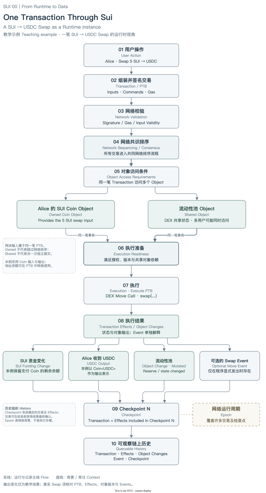
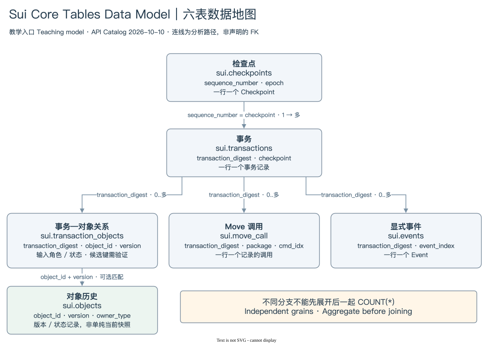

# SUI 00 | From Runtime to Data

## 从 Sui 如何运行，到链上数据如何组织

### 00.0 Before We Query Sui｜在查询 Sui 之前

打开 Dune，我们会看到 Transactions、Checkpoints、Objects、Move Calls 和 Events。懂 SQL 的读者可以直接查询，但很快会遇到更难的问题：一笔 Transaction 为什么关联多个 Object？同一个 Object 为什么出现多个版本？一次 Move Call 是否就是一次 Swap？查到 Event，是否就能证明资产已经转移？

这些问题关乎记录的含义。SQL 能正常运行，也可能把调用次数当作交易数，把历史对象余额当作当前余额。

在写第一条查询之前，我们先建立两张地图。Runtime Map 解释一次操作如何执行，Data Map 解释执行留下的记录如何进入数据表。协议运行的是交易、对象与状态；数据分析师研究的是这些运行过程留下的记录。先连接这两个世界，再讨论统计口径。

### 00.1 The Runtime Map｜一次操作是如何跑完的



[编辑 Runtime Map](./assets/runtime-map.drawio)

Alice 想把 5 SUI 换成 USDC。钱包需要把这个意图组装成 Transaction，再取得授权签名。图中的金额和参与者属于教学示例，没有对应真实 Transaction Digest。

普通用户操作通常由 PTB（Programmable Transaction Block，可编程交易块）表达。PTB 包含 Inputs 和 Commands，前一步产生的结果还可以作为后一步的参数。拆出支付 Coin、调用 DEX 函数、处理返回的 USDC，可以放在同一笔事务里。用户看到一次 Swap，网络看到的是一份带输入、操作和费用安排的请求。

请求进入网络后，需要检查签名、费用和输入是否合法。当前官方交易生命周期规定，所有交易都经过网络共识排序。图中的 04 是这条共同主线，05 再展开对象访问条件。Owned、Shared 等术语影响对象授权、版本确定和执行依赖，不能把它们画成“只有共享对象交易才进入共识”的开关。[交易生命周期](https://docs.sui.io/develop/transactions/transaction-lifecycle)

本例同时访问 Alice 的 Coin 与 DEX 的 Shared Pool。两者都是同一笔 Transaction 的输入。Coin 需要符合所有权约束；Pool 的读写需要按确定的顺序取得合适状态。图中两块对象汇入执行准备，表示同一事务需要满足两类条件。它们没有拆成两笔可以分别成功的交易。

Object 因而既是状态的组织单位，也影响交易能在什么时候、以什么权限使用状态。两个互不冲突的事务可以并行执行；两笔写入同一个 Pool 的事务则需要处理依赖。即使都属于 Owned Object，重复使用同一个可变版本也会产生冲突。Ownership 的完整分类还包括 Immutable、Object-Owned 与 Consensus-Address-Owned / Party，后面的模块会展开。[对象模型](https://docs.sui.io/develop/sui-architecture/object-model)

Execution 真正执行 Commands。成功的 Swap 可能改变支付 Coin、池状态，并产生 USDC 输出；具体是否新建 Coin、合并 Coin或转入地址余额，取决于真实 PTB 与合约。图中的输出是一种可能场景。Event 也取决于 Move 程序是否显式发出。

Transaction 描述“准备执行什么”，Effects 描述“实际执行结果”。失败事务同样可能留下状态、费用和错误记录，不能只根据钱包发起了 Swap 就断言兑换完成。PTB 的业务操作具有原子性，但失败不意味着费用为零。

随后，交易及 Effects 被纳入 Checkpoint，成为可验证历史。Checkpoint inclusion 与交易结果最终确认是不同观察点，不能将入列画成首次确定性的唯一条件。Epoch 是网络运行周期，跨越许多交易和 Checkpoint，因此放在旁注中。最后的 Queryable History 表示外部能读取历史，并非所有索引服务都在这一刻同步完成。[Checkpoint 验证](https://docs.sui.io/develop/sui-architecture/checkpoint-verification)

### 00.2 From Runtime to Records｜从运行过程，到链上记录

链上执行使用对象、交易、类型和状态转换。分析平台提供表、列和关联键。两者之间还有数据采集与加工。

```text
Protocol → Runtime → Onchain Records → Indexer / Data Platform → Tables
```

以刚才的 Swap 为例，协议需要知道输入对象、调用函数和执行结果。外部系统读取交易、Effects、Events、对象内容及 Checkpoint，再选择哪些字段保留为列，哪些嵌套数组展开成多行，哪些结果派生为计数或 JSON。

这里至少有三层边界。协议定义规定什么可以发生；链上记录说明这次执行实际留下什么；平台模型规定读者怎样查询这些记录。平台列名可能来自原生字段，也可能来自加工逻辑。看到 `move_calls` 计数列，并不意味着协议中存在一张同名原生表。

一个协议概念不一定对应一张表。一笔交易可以同时出现在交易表、对象关系表、调用表和事件表中；Effects 可能以 JSON 和多种派生列保存，而没有独立的 `effects` 表。反过来，对象关系行也不等于对象被修改：它可能只是输入或未变化对象。

因此，分析前要同时识别记录来源与行粒度。字段存在只是第一步，还要知道它表示输入、输出、版本、计数还是平台转换结果。数据库类比帮助理解关联结构；Object 的访问权限、版本承诺与执行依赖，则超出了普通数据库记录的含义。

### 00.3 The Data Map｜这些数据如何组织



[编辑 Data Map](./assets/data-map.drawio)

这张图以六张核心表作为入口，并不声称 Sui 或 Dune 只有六张表。2026-10-10 的 Dune Catalog API 确认了图中表名与字段；具体数据的新鲜度、完整历史范围和候选键唯一性，需要另做数据验证。图上的线表示分析连接路径，并非数据库声明的外键约束。[Dune Sui 目录](https://docs.dune.com/data-catalog/sui/overview)

先看主干。`sui.transactions` 以 Transaction Digest 识别事务；其 `checkpoint` 可以连接 `sui.checkpoints.sequence_number`。一条 Checkpoint 记录组织多笔事务。问“网络某段时间发生了多少笔事务”，通常从这条主干入手；问“一笔事务归入哪段历史”，则沿相反方向查找。

第二步，看一对多。交易表旁边的 `sui.transaction_objects` 表达事务与对象的关系，`sui.move_call` 表达记录的 Move 函数调用，`sui.events` 表达显式产生的事件。它们各自通过 `transaction_digest` 回到同一笔事务。一笔事务可以没有 Event，可以有多次 MoveCall，也可以涉及多个对象。

这些分支不共享同一种计数单位。两条调用记录表示两次记录的调用，并不自动表示两笔事务或两次兑换。三条对象关系记录，也不自动表示三次资产转账。最先应写清楚的问题始终是：结果的一行要代表什么？

第三步，看对象历史。`sui.objects` 保存平台记录的对象状态或操作信息，包含 `object_id`、`version`、`owner_type`、`object_status` 等字段。用 `object_id` 找到的是同一身份的历史线索；增加 `version`，才把查找限定到特定版本。但对象关系表中删除、未变化等记录未必都能在状态表中匹配到实体内容，不能先假定 INNER JOIN 不会丢失信息。[对象表](https://docs.dune.com/data-catalog/sui/objects)

连接键也有类型区别。当前 Catalog 中，Transaction Digest 是 `varchar`，Object ID、地址和 Package 多为 `varbinary`；序号与版本多为 `decimal(20,0)`。这些差别会决定过滤与转换方法。读者现在只需看清它们连接哪里，完整字段与 SQL 会在数据模型模块介绍。

最后，避免把图中的“1 → 多”误读为永远至少一条。事件与调用可能不存在，数据采集也可能有覆盖限制。Data Map 告诉我们到哪里找证据，证据是否齐全还需核查。

### 00.4 Connect the Two Maps｜把两张地图叠在一起看

| Runtime 世界 | Data 世界的入口 | 分析边界 |
|---|---|---|
| Transaction / PTB | `transactions` 与交易 JSON | 摘要计数不能还原全部参数和结果流 |
| Object Access | `transaction_objects` | 参与对象不一定发生写入 |
| MoveCall Command | `move_call` | 调用记录不能当作完整内部函数调用树 |
| Execution / Effects | 状态、Gas 列与 `effects_json` | 请求意图和成功结果需要分开 |
| 对象输出与变化 | `objects`、关系状态及 Effects | 历史版本不等于当前存活状态 |
| Move Event | `events` | 事件只覆盖程序显式发出的信息 |
| Checkpoint | `checkpoints` 与事务中的序号 | 历史组织不等于事务首次确认时间 |

这不是一一映射。Execution 产生的结果可能被平台放进多个位置；同一对象也可能以输入关系、输出状态和事件中的 ID 出现。它们的重复出现是不同证据视角，不意味着有多个对象。

从运行地图出发，我们问“执行需要什么状态”；转到数据地图，则问“哪份记录能证明访问或改变了这个状态”。例如，MoveCall 提供调用目标，Effects 提供成功状态与输出，Event 可能补充成交参数。分析师应根据问题组合证据，不能拿一个名称包含 `swap` 的调用替代全部业务确认。

有些运行时信息还不适合从这六张表直接推导。平台中的 Checkpoint 时间不等于钱包签名时间；Sender 不能单独证明现实身份；对象最后状态无法展示 PTB 内部每个中间值。理解边界，才能判断需要读取更完整的交易、对象历史，还是补充合约定义。

学习 Object、PTB 和 Checkpoint，最终是为了建立这种判断力。数据库提供查询路径，协议提供记录含义，两者一起决定 SQL 能回答什么。

### 00.5 One Transaction, Two Views｜同一笔交易，两种视角

继续看 Alice 的教学 Swap。从协议视角看，她提交一笔 PTB，使用 SUI 资金，访问共享 Pool，调用 DEX 函数并处理输出。整个业务动作作为同一事务执行；若失败，不能把前一条 Command 当作已经独立完成的兑换。

从数据视角看，我们可能得到一条 Transaction 记录、多条对象关系、多条对象输出记录、一次或多次 MoveCall，以及零条或多条 Event。它们最后都能追溯到同一个 Transaction Digest，并由 Checkpoint 序号定位历史。

假设这个示例有两次 MoveCall、四条对象关系和两条 Event，直接把三个分支相连可能得到十六行。十六是连接组合数量，既不是事务数，也不是资金流次数。正确做法是先分别确定调用、对象关系与事件的粒度，再聚合或选择必要证据。

这些数字仅用于讲解 JOIN 的组合效应。真实 Swap 的 Package、Digest、金额、调用数量和对象变化需要从可核验记录取得。后面的实践模块会把教学场景与真实案例明确分开。

### 00.6 Why This Matters for SQL｜理解运行机制后，SQL 会更容易

现在提出一个具体问题：“一段时间内，某个 DEX Package 涉及多少事务、Move 调用和相关对象活动？”

先从调用表确定目标 Package 和时间窗口，用不同 Transaction Digest 形成事务集合。这个集合回答的是“包含指定 Package 调用的事务”，不必然等于全部 DEX 用户操作；代理、升级 Package、路由组合与内部调用覆盖都需要考虑。

然后分别统计三种量。事务数是集合中不同 Digest 的数量。Move 调用数是满足所选调用范围的记录数。对象活动数必须进一步决定口径：关系行数、不同 Object ID、对象版本数，或特定状态变化数。若需要 Event 数，也应独立定义事件类型与覆盖范围。

不要把所有明细先 JOIN 再 `COUNT(*)`。可以在事务粒度上分别聚合分支，再连接汇总；只需要筛选事务时，也可以使用 EXISTS。DISTINCT 有助于实现已经确定的口径，却不能替我们决定口径。

时间过滤同样来自模型。Checkpoint 时间适合组织链上历史，平台摄取时间适合观察延迟。使用同一日期窗口查询多个分支时，要保持时间解释一致，并检查数据是否到齐。查询成功与证据充分仍是两项检查。

从这里开始，全书会逐步放大两张地图：先认识对象身份与版本，再拆解事务与 PTB，理解所有权、Move、资产、执行结果和历史，最后进入 Dune 数据结构与 SQL 实践。SQL 并不困难，困难的是知道自己正在统计什么。

下一章：[SUI 01｜对象模型](../01-object-model/index.md) · [返回阅读目录](../README.md) · [本章核验来源](./sources.md)
