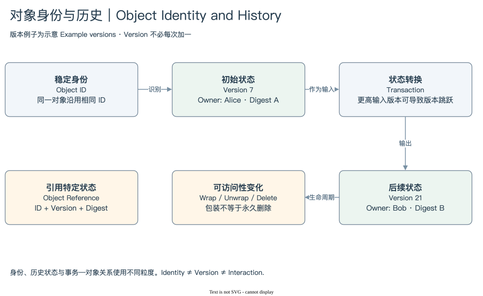

# 01.1 | ID、Version、Digest 与 Object Reference

Object ID 回答“是哪一个对象”。它在对象生命周期中承担稳定身份。Version 回答“这个对象的哪一个状态位置”。Object Digest 是内容及元数据的哈希承诺。三个字段一起构成常见的 Object Reference：`(ID, Version, Digest)`。

这三个问题不能互相替代。两个对象可以具有相同 Type，却有不同 ID；同一对象可以有多个版本；同一 ID 的版本改变以后，内容或元数据承诺也随之改变。不要把 Object Digest 与 Transaction Digest 混淆：一个识别对象状态，另一个识别事务。

[编辑原图](./assets/object-history.drawio)

考虑一个教学对象 O。它原来属于 Alice，Version 是 7，后来被转给 Bob。查询 O 的当前状态，可以看到 Bob；查询转移前的状态，则需要限定历史版本。若只按 ID 连接两张历史表，很容易让前后的状态一起匹配，产生看似合理却跨越时间的 Owner 关系。

版本严格递增，但不能默认每次都加一。Sui 使用 Lamport 时间思想，输出版本与参与事务的输入版本相关。O 的版本是 7，如果同一事务的 Gas 输入版本更高，O 的新版本可能直接跳到更大的数。版本间隔不是“漏掉了多少次修改”的计数器。[Object Versioning](https://docs.sui.io/develop/objects/versioning)

引用方式也与对象访问类别有关。普通 Owned Object 输入通常明确给出精确版本与 Digest。Shared Object 输入带有初始共享版本和访问方式，实际使用的状态版本由排序与执行准备确定。初始共享版本与本次实际访问版本不能混为一列含义。

对于分析师，最实用的做法是把键分成三层。追踪身份用 Object ID；核对特定状态用 ID 与 Version；验证内容时再保留 Digest 和来源。Dune Catalog 只能证明字段存在，不能证明每张表里的这些组合都唯一。唯一性仍要通过重复检查和数据层说明确定。

地址和 Object ID 在展示时都可能是 `0x` 开头的长字符串，但用途不同。一个地址是访问或接收主体，一个 Object ID 是对象身份；某些父子所有权场景又会把对象 ID 当作接收地址使用。字段形状相同，不意味着概念相同。

下一步：[对象生命周期](./02-lifecycle.md) · [模块入口](./index.md)
