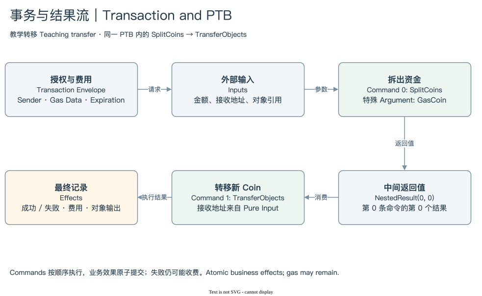

# SUI 02 | Transactions and PTB

## 用户到底提交了什么？

Object 是状态。Transaction 是请求状态发生转换的一份描述。它告诉网络由谁发起、准备使用哪些输入、执行哪些操作、由谁承担费用，以及这份请求在什么范围内有效。Transaction 并不预先保证这些意图会成功，执行结果仍要查看 Effects。

中文里的“交易”容易让人想到资产买卖，本书也使用“事务”提醒读者它的范围更宽。转账、发布代码、创建对象、调用应用，以及多个动作的组合，都可以由 Transaction 表达。网络还有管理运行状态的 System Transaction；分析普通用户活动时，需要决定是否排除这些记录。

[编辑原图](./assets/ptb-flow.drawio)

用户操作最常见的结构是 PTB。它由 Inputs 和 Commands 组成，Commands 的结果可以继续流向后面的 Commands。为了阅读，本书将这种能力概括为 `PTB = Inputs + Commands + Result Flow`。其中 Result Flow 是理解数据依赖的教学表述，不是另外增加的协议顶层字段。

假设 Alice 从 Gas Coin 拆出 1 SUI，再将新 Coin 转给 Bob。两条 Command 分别是 SplitCoins 和 TransferObjects。第二条使用第一条生成的结果，不需要等待另一笔事务完成，也不需要把中间 Coin 先单独落地、再重新读取。这是同一 PTB 的内部数据流。

这层结构解释了为什么一笔 Transaction 不等于一次 MoveCall。PTB 可以包含多次 MoveCall，也可以只用原生命令完成转移。它还可以先 Swap，再 Deposit，最后处理仓位对象。调用数与业务动作数没有天然一一关系；同一 Command 的中间结果也未必会成为链上独立对象输出。

PTB 的 Commands 按顺序执行，业务效果在事务边界原子提交。某条 Command 失败，之前的业务修改不会作为独立成功事务保留下来。失败仍可能收费，Gas 处理也可能改变费用相关状态。原子性约束业务效果，不承诺“失败时链上没有任何记录”。[What is a PTB?](https://docs.sui.io/develop/transactions/ptbs/prog-txn-blocks)

从数据角度，这份描述可能被平台保存为完整交易 JSON，也可能只抽取 Sender、调用数量、Command 计数等列。想回答“这笔事务做了多少次 MoveCall”，摘要列可能足够；想回答“第二条调用的资金来自哪里”，就需要 Inputs、Arguments 与结果引用。选择记录详细程度应跟着问题走。

本模块复用既有 SUI 02 的核心模型，分别解释外层授权与费用、内部参数与结果流。学完之后，读者应能把一份复杂 PTB 拆成外部输入、内部依赖和最终结果，再带着这份结构去核对 Effects。

[外层请求](./01-envelope.md) → [内部结果流](./02-result-flow.md) → [模块总结](./summary.md) · [返回目录](../README.md)
