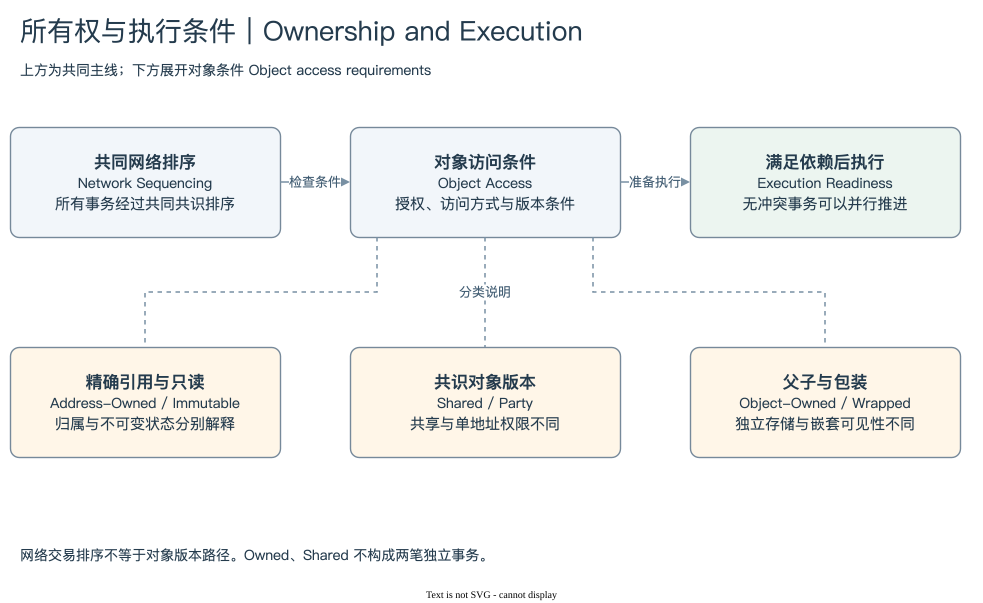

# SUI 03 | Ownership and Execution

## 对象归谁，怎样才能执行？

看到一个 Shared Pool，很容易把“任何人可以引用它”理解成“任何人可以随意修改它”。这会漏掉 Move 程序的访问规则。看到一个 Owned Coin，又容易把“只有所有者可以使用”理解成“交易完全不用网络排序”。这会把对象版本路径与交易生命周期混在一起。

本模块将问题拆成三个维度。Ownership 描述对象的归属与访问形式；访问方式描述本次事务准备只读、可变借用还是按值消费；版本与依赖处理决定它在执行时使用哪个状态。这些条件共同影响执行，却不是同一个标签。

[编辑原图](./assets/ownership-paths.drawio)

Address-Owned Object 由指定地址拥有，普通可变访问需要符合该归属的授权。Shared Object 可被不同地址引用，业务动作仍受合约控制。Immutable Object 可以被读取，不能再修改、转移或删除。Consensus-Address-Owned / Party 保留单地址归属，同时采用共识版本机制。一个对象还可能由另一个对象拥有，或者被包装在其他对象内部。[Ownership](https://docs.sui.io/develop/objects/object-ownership)

这些形式说明 Owned 与 Shared 并不穷尽对象模型。Move Type 也不能代替 Ownership。同一个 NFT Type 可以有不同归属；共享 Pool 的业务类型说明它保存哪些状态，Shared 则说明它如何被访问。分析时最好保留完整 Type、Owner 形式与具体访问角色。

当前官方生命周期说明所有交易经过共同共识排序；部分对象文档仍使用 Fastpath 说明精确版本引用与对象锁定。为了避免歧义，本书把“网络对事务排序”和“对象版本如何确定”分开。普通 Address-Owned 输入由发送方指定精确引用，共享与 Party 对象则具有相应共识版本与依赖约束。Fastpath 一词不能在本书中被简化为绕过当前网络排序。[交易生命周期](https://docs.sui.io/develop/transactions/transaction-lifecycle)

这种区分直接影响案例解释。一笔 Swap 同时使用 Owned Coin 与 Shared Pool，整笔事务必须满足全部输入条件。Coin 的授权正确并不能跳过 Pool 依赖；Pool 可以引用也不能让另一个人的 Coin 变得可用。PTB 的业务边界保持完整，不应画成两次独立执行。

并行执行则取决于冲突与依赖。不同对象上的可变写入往往能独立推进；读取同一不可变对象不产生同样的写入冲突；共同写入一个热点 Pool 会形成依赖。仅凭对象数量或业务复杂度，无法准确推导事务的并行能力或耗时。

学习这部分不是为了在 SQL 中模拟共识，而是为了读懂对象关系。一个对象被列为输入、一个版本被指定、一个共享状态被修改，分别意味着不同约束。后面统计活动和还原结果时，这些区别会决定哪些记录能证明什么。

[所有权形式](./01-forms.md) → [协调与并行](./02-coordination.md) → [模块总结](./summary.md) · [返回目录](../README.md)
