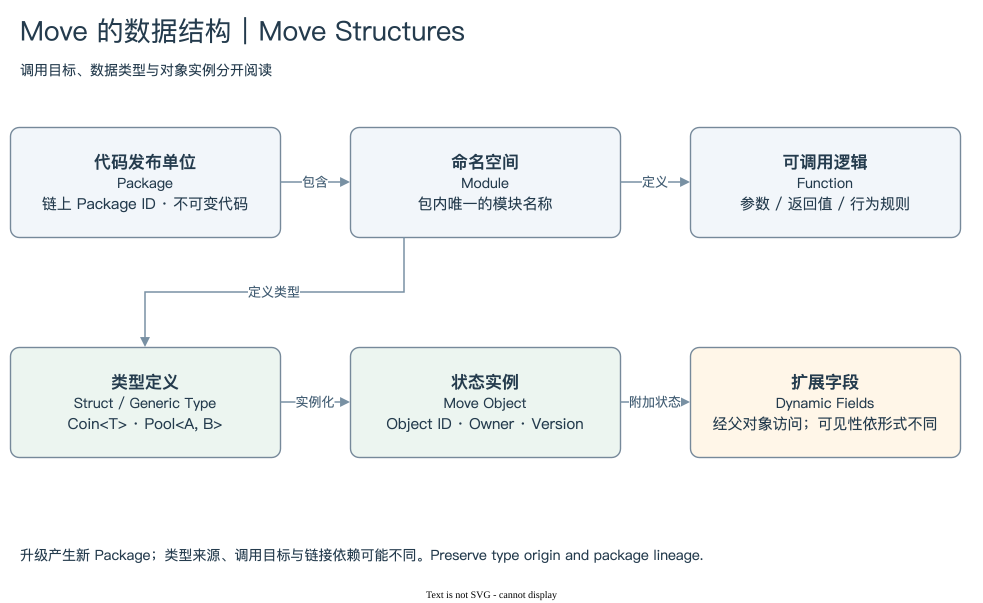

# SUI 04 | Move for Data

## 一串类型名，怎样变成可以理解的业务？

面对 `Package::Module::Name<T>`，数据分析师不必先学会开发整个 Move 应用。先识别它指向代码、类型还是状态实例，就能解决许多查询问题。调用目标说明使用哪段逻辑，Type 说明值是什么，Object ID 说明具体是哪一个实例。

Package 是发布与升级的单位，包含多个 Module。Module 提供命名空间，定义 Function 与 Struct。Function 表达可执行逻辑，Struct 表达数据结构；一个 Struct 是否成为独立 Sui Object，还取决于类型能力和 UID 等要求。并非每个 Move 值都有 Object ID。[Writing Move Packages](https://docs.sui.io/develop/write-move/)

[编辑原图](./assets/move-structure.drawio)

本书把 Package、Module、Function 看作识别调用目标的坐标。例如 `P::pool::swap` 指向某个包中的 pool 模块和 swap 函数。单独的 `swap` 不足以确定业务，两个完全不同的 Package 可以使用同名函数。统计协议活动时，至少要保留 Package 与必要的 Module/Function 范围。

Type 则提供另一个方向。`Coin<T>` 的 T 识别币种，`Pool<A,B>` 的参数可以帮助识别池中的资产类型。实例对象仍有自己的 ID、Owner 和 Version。两枚 Coin 可以具有同一币种 Type，同时拥有不同身份和余额。

泛型参数需要完整保留，不能只按 Struct 名称汇总。`Coin<SUI>` 与 `Coin<USDC>` 都叫 Coin，资产含义却不同；同名 Symbol 也不能替代完整 Coin Type。遇到很长的嵌套 Type 时，可以做解析视图，但原始字符串应保存，以便核查与重新解析。

升级使这层关系更加重要。用户 Package 的升级通常产生新的 Package ID，旧代码仍然保留，既有 Type 又可能继续指向最初定义它的来源。调用 Package、类型来源与依赖链接是相关但不同的身份。只过滤最新一个 Package ID，可能漏掉仍在使用旧版本或路由入口的事务。[Upgrading Packages](https://docs.sui.io/develop/publish-upgrade-packages/upgrade)

对象内容也未必全部放在一个 Struct 的固定字段里。Dynamic Fields 可以把更多状态关联到父对象；Dynamic Object Fields 又提供不同的对象可见性。只读父对象 JSON，可能看不到整个业务状态。这解释了为什么某次调用改变了子对象，父对象摘要却看起来没有显著变化。

本模块保持数据视角：看懂调用目标、识别资产与状态 Type，理解升级与子状态关系。我们不需要完整 Move 编程教程，但需要知道查询中哪些名称具有身份意义，哪些只是显示标签。

[类型与 Package](./01-types-packages.md) → [动态字段](./02-dynamic-fields.md) → [模块总结](./summary.md) · [返回目录](../README.md)
