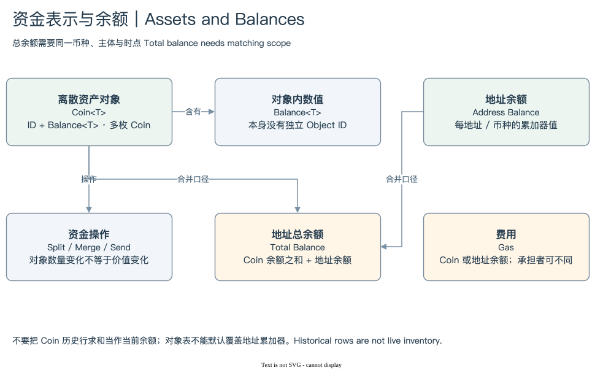

# 05.1 | Coin<T>、Balance<T> 与 Split / Merge

`Coin<T>` 同时具有对象身份和资产数值。Object ID 识别容器，T 识别资产，Balance 表示原始整数金额。`Balance<T>` 只表达同一类型资产的数值，不具有独立 Coin Object 的身份。池储备通常需要从实际对象类型与字段解释，不能只查地址名下的 Coin。[coin.move](https://github.com/MystenLabs/sui/blob/main/crates/sui-framework/packages/sui-framework/sources/coin.move)

SplitCoins 从既有 Coin 拆出指定金额的新 Coin。MergeCoins 将来源 Coin 的价值合入目标 Coin，来源身份被消费。二者改变对象结构，但本身不是增发或销毁资产供给。供应量变化需要核对 Mint/Burn 与相应权限和状态，而不能只看 Coin 被创建或删除。

[编辑原图](./assets/asset-balance.drawio)

例如 Alice 把 5 SUI Coin 拆出 1 SUI 再转给 Bob。最终可能保留一个余额减少的 Coin，并产生一个属于 Bob 的新 Coin。若她直接把整枚 5 SUI Coin 转走，同一 ID 可以改变 Owner。业务都是转移，对象变化却不同；对象 Created 数量不能当作转账次数。

T 必须保留完整类型。两种资产可以使用同一 Symbol，桥接资产与原生资产也可能展示相近名称。`Package::Module::Struct` 及泛型参数比短名称更接近链上身份。升级时还要关注 Type 来源，不能随意用最新调用 Package 替换资产 Type 中的地址。

显示金额则来自 decimals。若一种已核验资产的精度是 6，原始整数 1,000,000 表示 1 个显示单位。转换应避免把大整数先丢进低精度浮点运算再求和。原始数量、显示数量和美元估值是三层数据，价格来源与时点应另行登记。

CoinMetadata 提供名称与精度等元数据，当前 Currency 标准还通过 CoinRegistry 管理相关信息。不能假设所有资产都只有同一种元数据发现路径。元数据可以帮助展示，却不能单独证明资产真实性、发行主体或价格。[Fungible Tokens](https://docs.sui.io/onchain-finance/fungible-tokens)

统计钱包 Coin 时，先取得同一时点存活、由目标主体直接拥有的集合，再按 Coin Type 聚合原始余额。历史表中的前后版本不能一起求和。下一节将说明即使这步正确，地址累加器仍可能让“Coin 总和”只覆盖钱包资金的一部分。

下一步：[地址余额与费用](./02-address-gas.md) · [模块入口](./index.md)
