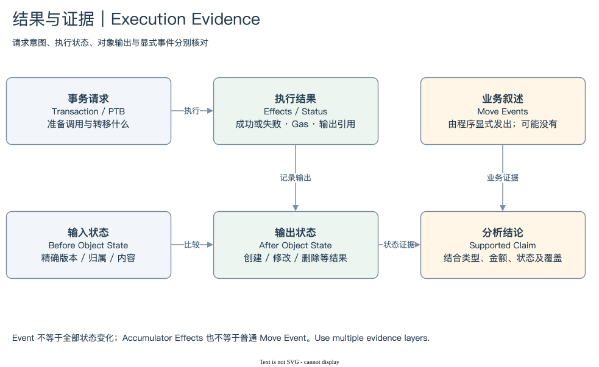

# SUI 06 | Execution, Effects and Events

## 怎样证明请求真正产生了结果？

钱包发出了 Swap 请求，MoveCall 的名称也包含 swap，仍不足以证明兑换成功。请求可能执行失败，调用可能只是路由中的一步，输入金额也可能是最大允许值而非实际支出。需要把请求与结果分开读取。

Transaction 和 PTB 表达意图，Effects 表达执行结果及协议层变化，Event 表达 Move 程序显式写出的业务信息，对象状态则提供执行前后内容。这四份材料经常互相补充，但不能互相替代。

[编辑原图](./assets/result-evidence.drawio)

Effects 首先回答执行是否成功。成功以后再读取输出状态，判断哪些对象被写入、创建、消费或删除，以及费用如何处理。失败也可能形成 Effects 与链上历史，记录错误及 Gas 结果。提交前被拒绝的请求则可能没有同样的链上事务记录，不能把这两类失败混在一个指标里。[Transaction Effects](https://github.com/MystenLabs/sui/blob/main/crates/sui-types/src/effects/mod.rs)

对象变化又有两层。协议 Effects 提供结果引用与状态转换证据；接口或平台可能据此生成易读的 Object Changes、Owner 转移标签、JSON 与计数。看到 `mutated=3` 可以了解摘要，但不能只用这个数字证明三个对象都发生同一种业务变化。

Event 更适合补充应用语义。例如 Swap Event 可能提供 Pool ID、币种方向、投入、产出与费用。哪些字段存在、表示原始整数还是显示金额、是否覆盖全部路由步骤，都要查看事件类型与发出它的代码。事件不是网络自动为每次状态变化生成的流水。[Emitting Events](https://docs.sui.io/develop/accessing-data/using-events)

当前资金模型还有协议累加器 Effects。它们与普通 Move Events 不属于同一层。如果仅从事件表寻找所有资金变化，可能漏掉地址余额和其他没有显式业务事件的动作。余额变化视图也可能是对象与累加器结果的派生，需保留计算来源。

本模块的核心方法是按问题选择证据。判断调用成功，用执行状态；判断某 ID 是否转移，用对象前后归属及对应 Effects；解释成交参数，用合约与 Event；核对钱包净资金，用覆盖完整的余额变化与费用。证据组合不是多余工作，它让相同记录能够支持不同层次的结论。

当材料不足时，保留较窄结论。例如“这笔成功事务包含某 Package 调用”往往比“某用户完成一笔特定金额 Swap”更容易证明。随着类型、资金与对象证据补齐，再扩展解释范围。

[Effects 与失败](./01-effects.md) → [Events 与证明](./02-events.md) → [模块总结](./summary.md) · [返回目录](../README.md)
