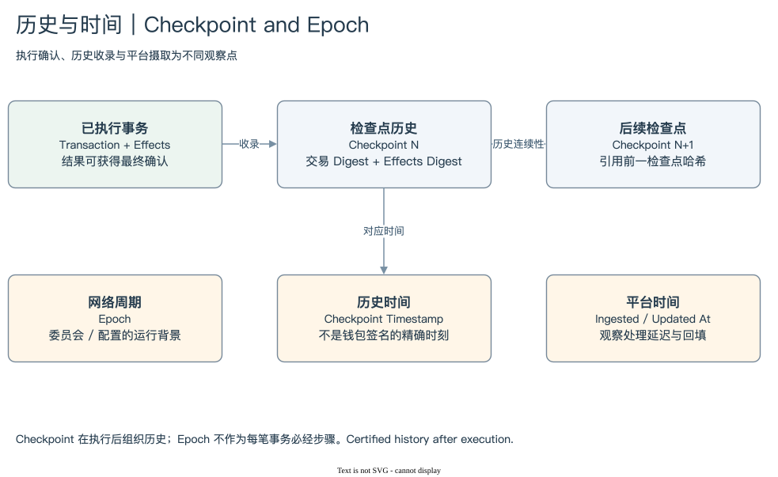

# SUI 07 | Checkpoint and Epoch

## 一笔结果，怎样进入可以验证的历史？

分析师常用时间范围查询事务，却不一定知道这个时间是什么。钱包签名时间、事务执行确认时间、Checkpoint 时间与平台摄取时间描述不同观察点。如果不先区分，延迟、日活和吞吐指标就容易混用口径。

Checkpoint 将已执行事务及其 Effects 组织成带证明的历史结构。它包含对前一 Checkpoint 的哈希关联，以及所收录事务和 Effects 的承诺。验证者签名使外部系统能核对历史是否来自相应委员会。它在用途上提供类似历史批次编号的入口，但不是把 EVM Block 简单改名。[Checkpoint Verification](https://docs.sui.io/develop/sui-architecture/checkpoint-verification)

[编辑原图](./assets/history-time.drawio)

Runtime Map 将 Effects 之后接到 Checkpoint，是为了说明结果进入历史。它不表示所有事务必须等到收录才能获得首次最终确认。当前生命周期描述通过足够验证者确认 Effects 或由认证 Checkpoint 提供结果证明的方式。分析结果确定性与索引可见性，需要分别确认观察来源。

Data Map 中，Transaction 的 checkpoint 指向 Checkpoint Sequence。这个连接让我们定位事务所在批次、对应时间和 Epoch。一个 Checkpoint 可以收录多笔事务；它们共享的时间字段不是每笔钱包请求独有的时间戳。用这些时间计算间隔，应承认批次时间的精度与含义。

Epoch 是更大的网络运行周期。委员会与相关运行配置提供周期背景，边界完成重配置等网络动作。一个 Epoch 包含许多 Checkpoint 和事务，不能画成每笔事务在 Execution 后必须单独通过的一道处理步骤。[Epochs](https://docs.sui.io/develop/sui-architecture/epochs)

历史分析还需要处理持续增长与平台延迟。链上已经确认，不代表 Dune 各表同步到齐。Checkpoint 主干先到、事件分支后到时，一次 JOIN 可能出现临时未匹配。平台摄取与更新时间提供加工时间线索，却不能直接替代链上时间。

统计网络活动时，事务数、PTB Command 数和 Checkpoint 数仍是不同计量单位。一段时间内平均每秒的事务数，需要定义分子是否排除 System Transaction、是否只算成功，并说明窗口长度。不要直接把平台名为 total_transactions 的列当作不言自明的业务事务数。

本模块把结果、历史证明与时间组织连接起来。后面做 SQL 时，我们使用 Checkpoint 定位记录，也保存摄取时间与验证日期，让读者知道结果对应链上哪个位置，以及数据是否已经完整到达。

[Checkpoint 与确认](./01-checkpoint.md) → [时间与 Epoch](./02-time-epoch.md) → [模块总结](./summary.md) · [返回目录](../README.md)
