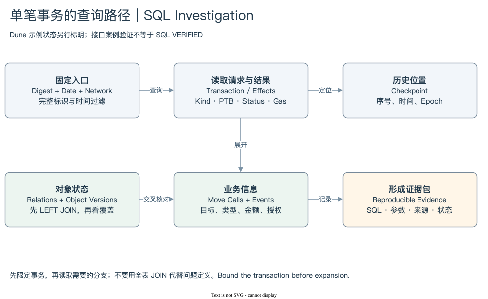

# 09.2 | 从 Package 调用验证 Swap

案例 B 的 Digest 为 `5ounE6vvNursjwLpNCUgF8ybtnNfqVbV91fYdpACgBHq`。它位于 Mainnet Checkpoint 314284234，时间为 2026-08-24 05:14:52.293 UTC，状态 SUCCESS。官方快照包含 39 条 Command、18 条 MoveCall、19 条 Event，事件页明确没有下一页。

它是一笔多路由兑换，包含合并 Coin 和多个池步骤。发送地址的余额变化只有 SUI 与 USDC 两种资产：SUI 净减少 45,839,344,920 MIST，USDC 原始数值增加 38,191,592。该 Coin Type 的官方元数据已核实 decimals=6，因此后者为 38.191592 USDC；这个转换依据完整 Type 与元数据，不只依据 Symbol。

[编辑原图](./assets/sql-route.drawio)

费用在这个案例里尤其重要。计算费与存储费减返还，得到净 Gas -86,387,304 MIST。这表示存储返还超过所列成本。因此钱包 SUI 净减少量不能直接称为全部 Swap 投入；在明确没有其他 SUI 出口的边界下，剔除这项费用结果后的业务净减少量为 45,925,732,224 MIST。它仍是事务级净变化，不是每一个路由步骤的金额。

事件中可以看到不同 Package 的 Swap、Flash Repay 和费用状态记录。中间资产周转不能全部相加当作用户最终成交量。某条 Event 提供池步骤，Effects 与余额变化提供事务边界，两者回答不同问题。

Dune 分析先分别读取 [MoveCall](./sql/03-move-calls.sql) 与 [Events](./sql/04-events.sql)，再核对 Digest、调用索引、事件类型及 JSON。当前 SQL 尚未执行，18 与 19 是官方接口的比对目标，不能假定 Dune 展开必然一致。

如果要分析指定 Package 的每日活动，可使用 [05 SQL](./sql/05-package-metrics.sql)。它先形成调用事务集合，分别在 Digest 粒度聚合对象关系和事件，再连接主干。package_call_rows、object_relationship_rows、distinct_object_ids、all_event_rows 分别保留口径；它们不被统称为 Swap 数。

05 SQL 只覆盖一个实际观察到的调用 Package，不能表示全部协议或全部路由。升级 Package、代理入口与内部调用需要另建映射。把它解释为包含该 Package 记录调用的用户事务，比直接贴上某 DEX 总交易量标签更准确。

读到这里，应能把开篇简化 Swap 与真实复杂事务连起来：同一业务边界里有多个输入、调用和事件，最终解释必须依赖成功状态、对象类型和资金证据，而不仅是函数名称。

下一步：[追踪 Pool 历史](./03-object-history.md) · [案例证据](../references/verified-transactions.md)
