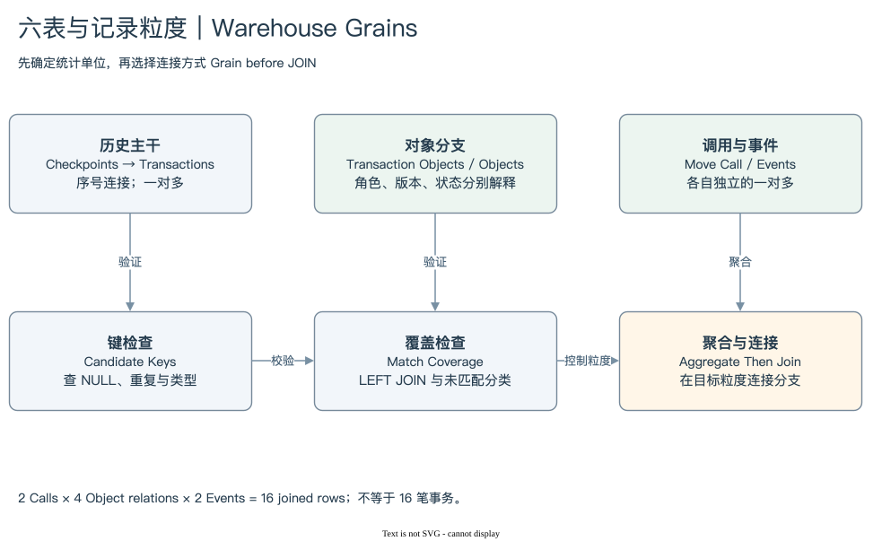

# 09.4 | 从已有 Query 复用网络指标

本书还读取了 slowmoonship 已有的 Sui Dashboard 与十二份完整 Query SQL。它们将网络、Shared Object 与 Package 活动分别建立每日事实，再供趋势、排行与集中度视图使用。复用这套分层，比重新写一个六表大 JOIN 更容易保持指标含义。

网络主干 [8347640](https://dune.com/queries/8347640) 分别按日聚合 Checkpoint 和事务，再以日期连接。这个顺序避免将一个 Checkpoint 的多笔事务重复复制到检查点统计。Checkpoint Gap 使用连续序号筛选，也提醒读者间隔与缺失行需要分别解释。

[编辑原图](../08-dune-model/assets/warehouse-grains.drawio)

Shared Object 事实 [8348381](https://dune.com/queries/8348381) 按日期和 Object ID 分组，同时保存不同 Digest 数与关系行数。一个对象的活跃事务和关系记录，因而没有被混成一个数。它使用 SharedInput 过滤，需要另核实当前值域与对 Party 对象的覆盖，不能把结果称为全部共识对象活动。

Package 事实 [8348409](https://dune.com/queries/8348409) 同时统计调用行、不同事务、Module 和 Function。为同一 Package 保留调用数和事务数，正是前面两张地图要求的粒度意识。相应的排行 Query 还区分观察期数量与活跃天数，避免只凭某一天名次推导长期活跃度。

本轮还读取了该 Query 的已完成缓存执行 `01M05BA97JDYZ1EM2S3SG5C0A1`，执行时间为 2026-08-16。取出的一行描述 2026-05-10 某 Package：17,750 次调用，对应 2,623 笔事务。这是历史执行中的一行，不是当前网络状态，也不能据此保证当前保存的 SQL 版本与当时完全一致。[缓存证据](../_project/cache/existing-dune-queries/8348409-latest-result.json)

这些历史 SQL 是素材，不能当作本轮验证完成的结果。网络事实的窗口长达 365 天，Shared 和 Package 为 180 天；入门复现应先缩到一天。PTB 分桶使用 transaction_count，需要核对其当前口径；原分桶还会把 NULL 落入最后一个类别，实际使用前应独立处理缺失。

[09 SQL](./sql/09-historical-package-grain.sql) 在本地保留 Package 事实的两个核心计数，并限定一天。它静态核对当前 Schema，未在 Dune 执行。历史 Query 的原始 SQL 没有改动，完整副本、版本、来源和依赖登记在 [复用清单](../references/dune-queries.md)。

复用的重点是保留经过思考的结构，同时重新检查字段、时间范围与指标解释。旧 Query 有真实身份，也仍可能存在语义或数据覆盖缺口；它们值得继续研究，不应被自动覆盖或直接标为 VERIFIED。

下一步：[模块总结](./summary.md) · [模块入口](./index.md)
