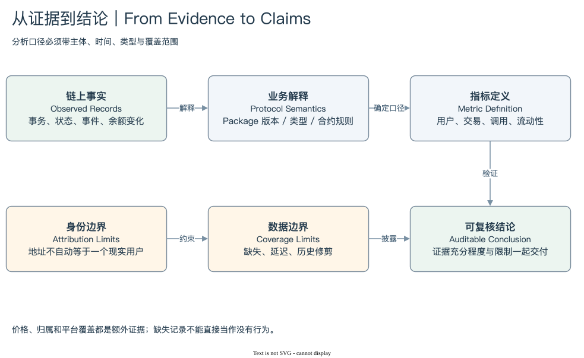

# SUI 10 | Analysis and Audit

## 从记录出发，可以支持多大的结论？

一笔事务的解释相对有界：固定 Digest，读取请求和结果。扩大到钱包、协议与资金流以后，困难往往来自主体和统计边界，而不是 SQL 语法。一个地址是否代表一个用户，一个调用是否属于某个协议，一个池的状态是否代表全部流动性，都需要额外定义。

本模块选择两个扩展方向。钱包分析连接地址活动、余额与资金变化；协议分析连接 Package 谱系、业务对象和指标。我们不建立无边界的生态项目目录，而把已有知识转成可重复使用的方法。

[编辑原图](./assets/audit-evidence.drawio)

链上记录能够直接支持某些事实。例如某地址发起成功事务，某个对象版本属于指定 Owner，某笔事务出现某 Type 的净余额变化。这些事实并不自动证明现实身份、最终受益人或全部经济行为。一个地址可以由多签或应用控制，一个人也可以使用多个地址。

协议范围同样需要证据。最新 Package ID、旧版调用、路由入口和 Type 来源可能分散在不同身份下。只按一个 Package 统计，得到的是一个明确入口的活动；把它扩展成全协议用户，需要说明谱系、内部调用覆盖与业务识别条件。

资金流还存在状态与流量的区别。当前余额描述某个时点，事务余额变化描述一个业务边界的净结果；Event 则可能描述中间池步骤。多路由、赞助费用、Coin 合并与 Address Balance 都会改变记录形态。使用某种记录之前，要明确它回答的是存量、净流量还是步骤流量。

流动性分析则回到 Move Type 和对象状态。一个 Pool 可以有储备、费用、tick 与动态子状态，用户 Position 又可能在其他对象中。仅凭 Coin Balance 或某个字段名称，无法保证已测量全部可交易流动性。估值时还需明确价格时点和资产身份。

审计的目标，是让证据充分程度与结论强度一致。数据缺失时保留较窄结论，发现升级或模式变化时更新映射，不能为了图表连续而把未知值静默当零。保存完整 SQL、窗口、标识、返回快照和验证状态，使另一个人能够重做同样的判断。

读完之后，读者应该能够设计一个有边界的钱包或协议分析：先定义主体、行为、粒度与时间，再选择证据和查询路径，最后交付结果与限制。这样的分析能扩展，也能被质疑和改进。

[钱包与资金流](./01-wallet.md) → [协议与复核](./02-protocol.md) → [模块总结](./summary.md) · [返回目录](../README.md)
