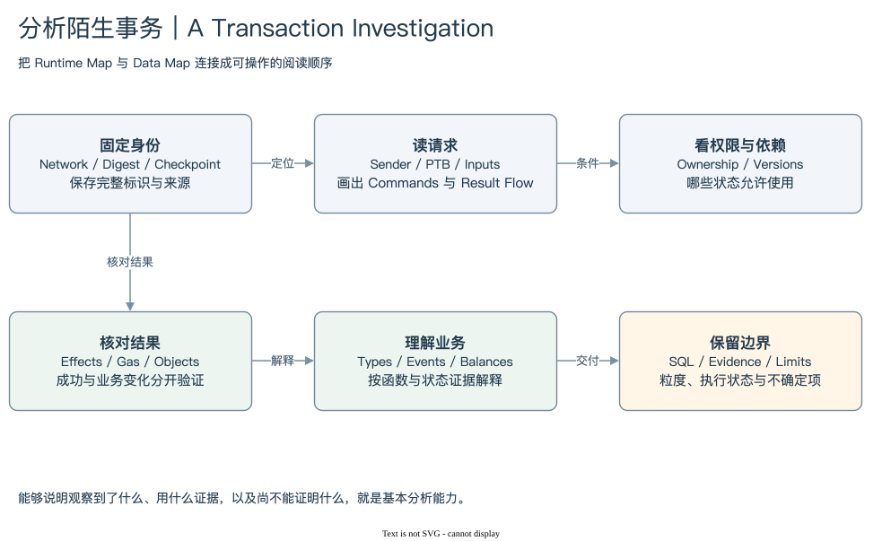

# SUI 99 | From Data to Understanding

## 现在给你一笔陌生事务

先固定身份。保存网络、完整 Transaction Digest、查询来源和取得时间。如果事务已有历史位置，再记录 Checkpoint Sequence、时间与 Epoch。不要只留下截图中的短哈希，也不要把另一个网络的对象或 Package 拼到同一案例里。

[编辑原图](./assets/analysis-checklist.drawio)

然后读取请求。识别 Transaction Kind、Sender、签名授权形式、Gas Owner 和支付模式。进入 PTB，列出 Inputs 与 Commands，标注每个参数来自普通输入、GasCoin 还是前序 Result。先画清内部数据流，再解释函数名对应的业务。

第三步，理解状态条件。Object ID 告诉你哪个对象，Version 告诉你哪个历史状态，Digest 提供内容承诺。区分普通 Owned、Shared、Immutable、Party、父子拥有与包装。不要把对象归属、只读访问和版本机制压成一个分类，也不要把混合输入拆成独立事务。

第四步，核对执行结果。先查看成功或失败，再看 Effects、费用、对象输入与输出。请求想转移什么与实际改变什么，要分别回答。失败可能收费；对象被创建不等于资产增发；Coin 被消费也不等于价值销毁。

第五步，解释业务。读取完整 Type 与 Package 谱系，核对 MoveCall 参数、Events 和资金结果。Event 不是自动状态流水，调用行不是完整事务。地址余额与 Coin 需要共同纳入资金范围，Sponsor 和存储返还则可能改变钱包净变化。

第六步，把证据放进表。Checkpoint 与 Transaction 构成历史主干，对象关系、调用和事件各自展开。先定义一行代表什么，再选连接方式。只需筛选时使用合适的存在条件；需要多种指标时分别聚合，避免明细组合复制数量和金额。

最后，交付可复核解释。保留完整 SQL、参数、来源、结果与验证状态；说明历史范围、候选键、索引覆盖和未知项。官方接口读取、Schema 核验、静态 SQL 与成功执行是不同验证层，不能混为一个通过标签。

本书的三个案例体现这套顺序。简单 SUI 转移说明零 MoveCall、零 Event 也能成功；多路由兑换说明一笔事务可以有许多调用与事件，还可能有负净费用；Shared Pool 历史说明相同身份持续演化，版本跳跃不等于漏掉同样多次修改。

现在独立分析的基本能力，不是背出所有术语，而是能回答四个问题：这份请求想做什么，实际产生什么结果，哪些记录支持解释，还有什么不能由现有证据证明。Runtime Map 提供运行条件，Data Map 提供查询路径，两者共同决定 SQL 的含义。

协议运行的是交易、对象与状态；数据分析师研究的是这些运行过程留下的记录。

**From Runtime to Data. From Data to Understanding.**

[重看 Runtime Map](../00-from-runtime-to-data/assets/runtime-map.svg) · [重看 Data Map](../00-from-runtime-to-data/assets/data-map.svg) · [返回全书目录](../README.md)
